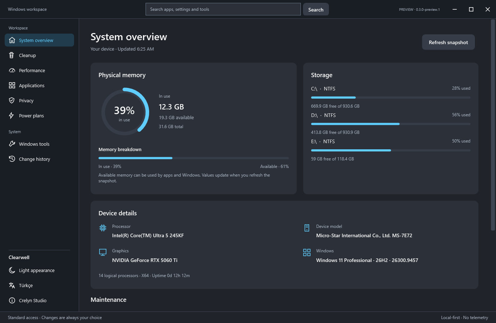
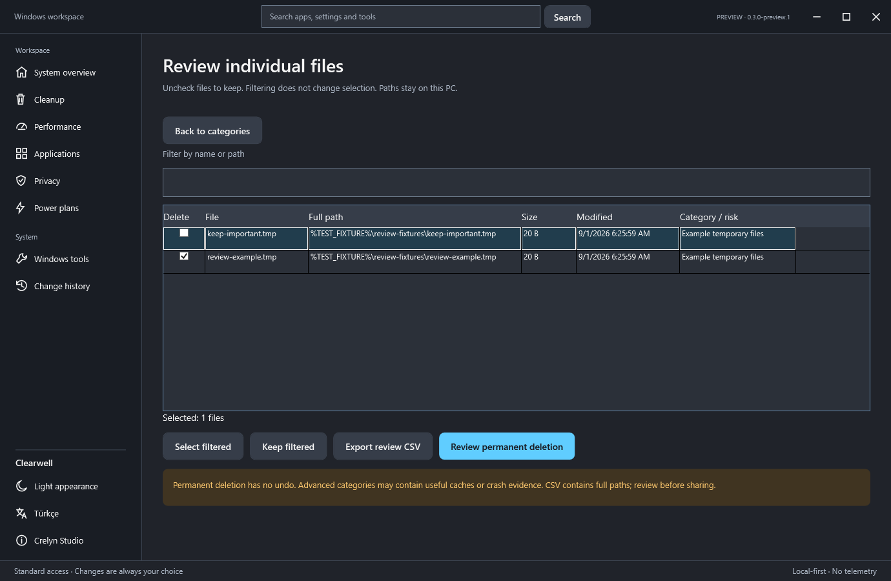
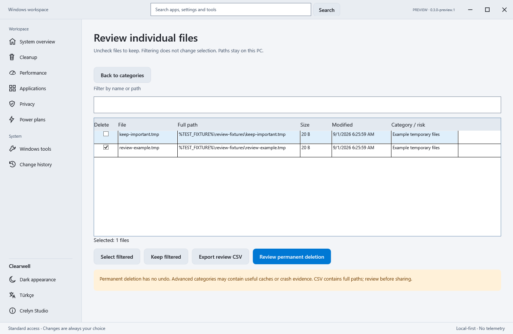
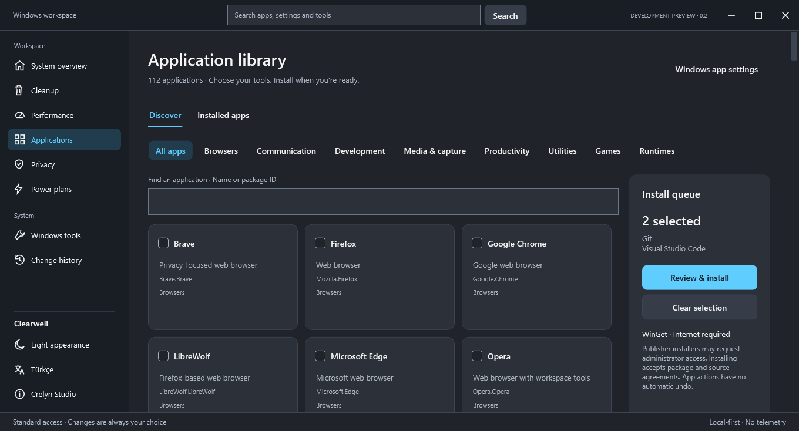
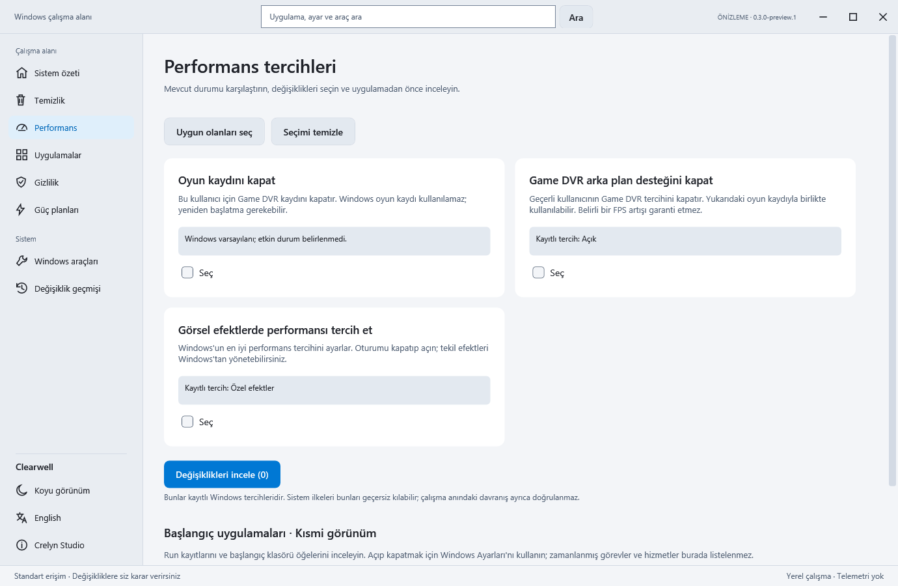
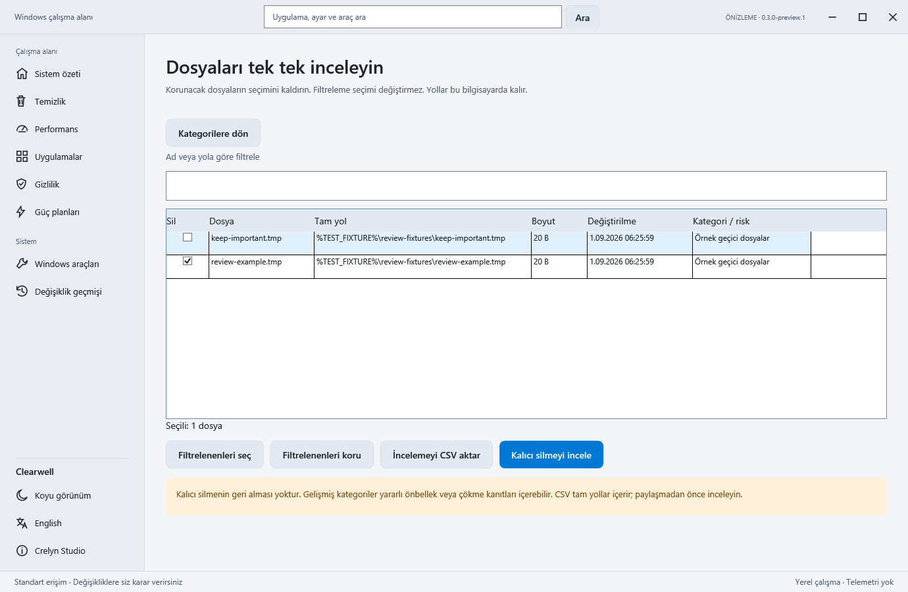

# Clearwell

Windows maintenance with a review before every change. Native C# / WPF, English and Turkish, light and dark appearances. Local data; no telemetry, account or API key.

**0.3.0-preview.1 is an unsigned development preview, not a stable release.** Live settings, power, UAC and installer tests on disposable Windows 10/11 machines remain required.

[Download preview](https://github.com/crelynstudio/crelyn-studio-clearwell/releases/tag/v0.3.0-preview.1) · [Changes](CHANGELOG.md) · [Audit and validation plan](docs/AUDIT-2026-10.md) · [Türkçe](#türkçe)

The download link becomes available after publication. Choose the Clearwell-0.3.0-preview.1-win-x64.zip application package; GitHub's automatic source archive is not an executable package.

## New in this preview

- Review individual cleanup files by name, full path, size, modification time and category; filter, exclude files and export CSV. Each deletion still verifies file identity.
- Keep files modified within 1, 7 or 30 days; the new default is **7 days**. Advanced categories remain unselected. Partial scans need a second confirmation. Skip reasons distinguish access, lock, links and I/O failures.
- Cancel WinGet operations/queues; stop process trees where possible and report unknown state for detached/elevated installers. Verify exact inventory after commands and review an installed target before uninstalling. Queues stop on failure or unverifiable inventory.
- Corrupt preferences no longer block valid recovery history. Repair preserves the damaged original. Read legacy history, write a versioned schema, and archive only undone records without losing actionable records.
- Keep the last 200 local activities without file paths/installer output. Export platform/error diagnostics locally. Optional current-user Store/MSIX discovery supplements desktop inventory.
- Windows CI, read-only catalog checks, and a single test/publish/ZIP/SHA-256/independent verification command. Workflows must run after source upload; a local pass is not a GitHub CI pass.

Review screenshots show **example fixtures**, not personal files. Verification mode substitutes %TEST_FIXTURE% for its isolated directory; normal use shows full local paths. Hardware/scan summaries are actual development-machine readings, not performance promises.

## Other features

On-demand CPU, active graphics adapter, Windows, physical memory, uptime and disk snapshots. Search pages, settings, tools and a curated 112-app library. Review a queue or exact WinGet ID; publishers' accounts, licenses and terms vary. WhatsApp uses Microsoft Store. Inspect partial startup entries, open ten Windows tools, choose user-scoped performance/privacy preferences, switch existing power plans and undo supported changes. No promised FPS increases or invented power plans.

## Run or upgrade

1. Download the preview ZIP and matching .zip.sha256. Compare the output below with the checksum file. A matching hash detects corruption; it is not a code-signing certificate.
2. Close the old Clearwell. Extract into a **new folder**, keep all included licenses/notices and open Clearwell.exe. The x64 .NET runtime is included. Do not disable Windows security for this unsigned preview.
3. Begin with standard user access and read-only scanning. Administrator restart requires Windows permission; another administrator account has separate data.

~~~powershell
Get-FileHash .\Clearwell-0.3.0-preview.1-win-x64.zip -Algorithm SHA256
~~~

Back up %LOCALAPPDATA%\CrelynStudio\Clearwell before upgrading. Old array-format history is read; new writes use schema 1. **After new recovery records are saved, do not downgrade to 0.2 with the same profile**: it cannot read the new envelope. A profile backup does not undo subsequent Windows changes.

## Build and check

Windows x64, PowerShell and **.NET SDK 10.0.401** (pinned in global.json). No third-party UI packages. First restore/publish needs internet for Microsoft packages. From this repository root:

~~~powershell
dotnet restore Clearwell.slnx --locked-mode
dotnet build Clearwell.slnx -c Release --no-restore
dotnet run --project src/Clearwell -c Release --no-build
dotnet run --project tests/Clearwell.Checks -c Release -- .\artifacts\checks-01
.\build-release.ps1
~~~

The checks folder must be new/empty. Checks delete only their fixture files, create a junction, test cancellation/child processes and read actual hardware/power plans. They do not change Windows preferences or install software. build-release.ps1 runs checks, publishes, creates ZIP/checksum, extracts independently and verifies version/UI. Outputs: artifacts/releases/. Existing releases are never overwritten. Validation evidence: ignored artifacts/release-validation-*/. Provenance is an unsigned local build record, not a supply-chain attestation.

publish.ps1 creates just the portable folder and runtime notices. With PowerShell 7, pwsh -NoProfile -File .\tools\Check-Catalog.ps1 performs read-only catalog queries without installation or accepting new source agreements. Unaccepted source agreements (0x8A150046) are reported as source-agreements-required with a warning: those entries remain unverified and do not fail the workflow. Other source/network/region failures and timeouts still fail the check. Run pwsh -NoProfile -File .\tests\Catalog.Checks.ps1 to test status handling without WinGet queries. Clearwell.exe --verify-ui <new-folder> uses an isolated profile, renders both languages/themes and compact sizes, checks dialogs/exclusions, and exits with result.txt without system mutations. Recreate the icon with powershell -NoProfile -STA -File .\tools\Export-Icon.ps1; vector source is Assets/Brand.xaml.

## Safety, privacy and limitations

- **Permanent deletion; no quarantine, recycle bin or undo.** Close other apps, inspect files and back up important data. Recent, linked, changed/replaced and inaccessible files are protected. Scan totals do not promise reclaimable space.
- Standard user/Windows Temp, Prefetch and crash dumps are scanned. A redirected local TEMP ending in Temp/tmp, outside protected roots with no reparse ancestors, appears as an advanced unselected category. UNC, broad/profile roots and other redirected names are intentionally excluded. Identity-checked handle deletion is retained.
- Recovery records precede settings/power mutations. Undo reconciles interrupted/already-restored actions, checks current state and requires the latest related record first. Outside changes are not overwritten. New writes reject non-DWORD registry preferences; legacy string originals remain restorable. History is not a Windows backup.
- Activity is local, bounded and separate from recovery. CSV contains full paths: review before sharing. Support export contains version/platform, operation areas/outcomes and error codes. No automatic upload.
- UI, cleanup, local history and Windows preferences work offline after installation. WinGet/source/catalog operations need source/network availability. No analytics, runtime CDN or background agent.
- Detached/elevated third-party installers can survive cancellation. Inspect their windows and re-read inventory before retrying. Unverified state is not proof of absence. No install/uninstall rollback.
- Desktop inventory uses uninstall registry entries; optional Appx/MSIX is current-user only and can include Windows packages. Startup inspection excludes services, tasks and RunOnce.
- Package architecture is x64. Windows 11 is locally exercised; Windows 10 22H2 remains a target pending VM validation. ARM64/x86 packages are not supplied. Actual screen-reader, physical 125/150/200% DPI, multi-monitor and high-contrast user tests remain pending; automated rendering/geometry checks do not replace them.
- No signing certificate. No stable-release claim until live operation/accessibility acceptance is completed. See all 36 audit findings and remaining work in the audit document.

Try language/theme persistence, resize, Tab/Shift+Tab/Space/Enter/Escape, read-only scan, exclude one file and cancel deletion. Inspect settings/startup/power without applying. Read desktop/Store inventory; export and inspect diagnostics. Test live mutations/UAC/installers only in a disposable VM with a snapshot.

## License and developer

[MIT](LICENSE), copyright 2026 Crelyn Studio. Microsoft runtimes have separate notices. Names/logos remain reserved brand assets; MIT grants no trademark rights. [Third-party notices](THIRD-PARTY-NOTICES.txt).

**Developed by Crelyn Studio.** [Website](https://crelynstudio.com) · [Email](mailto:info@crelynstudio.com) · [GitHub](https://github.com/crelynstudio). Developer/social links are in the app. Not affiliated with Microsoft or Chris Titus Tech; no WinUtil code bundled. [Contributing](CONTRIBUTING.md) · [Security](SECURITY.md).

---

# Türkçe

Her değişiklikten önce inceleme sunan yerel Windows bakım aracı. C# / WPF, İngilizce/Türkçe ve açık/koyu görünüm. Veriler cihazda kalır; telemetri, hesap veya API anahtarı yoktur.

**0.3.0-preview.1 imzasız geliştirme önizlemesidir; kararlı sürüm değildir.** Windows 10/11 sanal makinelerinde gerçek ayar/güç/UAC/kurucu testleri tamamlanmalıdır.

[Önizlemeyi indir](https://github.com/crelynstudio/crelyn-studio-clearwell/releases/tag/v0.3.0-preview.1) · [Değişiklikler](CHANGELOG.md) · [36 bulgunun durumu](docs/AUDIT-2026-10.md)

Bağlantı yayından sonra açılır. Clearwell-0.3.0-preview.1-win-x64.zip uygulama paketidir; GitHub'ın otomatik kaynak ZIP'i çalıştırılabilir paket değildir.

## Yenilikler ve özellikler

- Dosya adı/tam yol/boyut/zaman/kategoriyle tekil inceleme, filtre, dosya hariç tutma ve CSV aktarımı. Silme dosya kimliğini yeniden doğrular.
- Son 1/7/30 günü koruma; yeni varsayılan **7 gün**. Gelişmiş kategoriler başlangıçta seçili değildir. Kısmi tarama uyarısı/ek onay; erişim/kilit/bağlantı/G/Ç nedenleri.
- Kurulum/sıra sırasında iptal isteği, mümkün olan süreç ağacını durdurma ve ayrılmış kurucularda açık belirsizlik. Hata/doğrulanamayan envanterde sıra durur. Tam paket/kaynak doğrulaması ve kaldırma öncesi hedef incelemesi. WinGet için mutlak PATH yolları da aranır.
- Bozuk tercihler sağlam kurtarma geçmişini engellemez; düzeltme bozuk aslı korur. Eski geçmiş okunur, yeni yazımlar sürümlüdür. Yalnız geri alınmış kayıtlar arşivlenir; bekleyen/uygulanmış kayıtlar korunur.
- Tam yol/kurucu çıktısı içermeyen son 200 yerel etkinlik; yerel sürüm/platform/hata raporu. İsteğe bağlı geçerli kullanıcı Store/MSIX envanteri.
- Windows derleme/test/paket ve salt okunur katalog iş akışları; tek komutla ZIP/SHA-256/bağımsız kontrol. GitHub CI, kaynak yüklendikten sonra ayrıca çalışmalıdır.
- Gerçek işlemci/grafik/Windows/bellek/disk bilgileri; isteğe bağlı yenileme. Sayfa/ayar/araç/112 uygulamada arama ve sıralı kurulum. WhatsApp Microsoft Store kullanır; uygulamaların lisans/hesap koşulları farklıdır. Kısmi başlangıç, on Windows aracı, kullanıcıya özgü ayarlar, mevcut güç planları ve desteklenen işlemleri geri alma. FPS/hız artışı vaat edilmez.

Görüntüler bu sürümden alınmıştır. İnceleme görüntüleri **örnek test dosyalarını** gösterir; doğrulama kipinde test klasörü %TEST_FIXTURE% olarak görünür. Normal kullanımda tam yerel yollar gösterilir. Donanım/tarama miktarları gerçek geliştirme cihazı sonuçlarıdır; performans vaadi değildir.

## Çalıştırma ve güncelleme

1. ZIP ve .zip.sha256 dosyasını indirin. Get-FileHash .\Clearwell-0.3.0-preview.1-win-x64.zip -Algorithm SHA256 çıktısını karşılaştırın. Hash kod imzası değildir.
2. Eski Clearwell'i kapatın, ZIP'i **yeni klasöre** açın; tüm lisans/bildirimleri koruyup Clearwell.exe çalıştırın. x64 .NET dahildir. Windows güvenliğini kapatmayın.
3. Standart yetki ve salt okunur taramayla başlayın. Yönetici yeniden başlatması Windows izni ister; farklı hesabın verileri ayrıdır.

Önce %LOCALAPPDATA%\CrelynStudio\Clearwell klasörünü yedekleyin. Eski dizi biçimli geçmiş okunur, yeni yazımlar şema 1 kullanır. **Yeni kayıtlar kaydedildikten sonra aynı profille 0.2'ye dönmeyin**; eski uygulama yeni zarfı okuyamaz. Profil yedeği sonraki Windows değişikliklerini geri almaz.

## Geliştirme ve test

Windows x64, PowerShell ve global.json ile sabitlenmiş **.NET SDK 10.0.401** gerekir. İlk restore/yayın derlemesi Microsoft paketleri için internet ister. Üçüncü taraf arayüz paketi yoktur. Depo kökünde:

~~~powershell
dotnet restore Clearwell.slnx --locked-mode
dotnet build Clearwell.slnx -c Release --no-restore
dotnet run --project src/Clearwell -c Release --no-build
dotnet run --project tests/Clearwell.Checks -c Release -- .\artifacts\kontrol-01
.\build-release.ps1
~~~

Test klasörü yeni/boş olmalıdır. Testler yalnız kendi dosyalarını siler; junction ve süreç iptalini sınar; gerçek donanım/güç planlarını salt okunur okur. Windows ayarlarını değiştirmez/uygulama kurmaz. build-release.ps1 test, derleme, ZIP, SHA-256, bağımsız çıkarma ve sürüm/arayüz kontrolü yapar. Çıktılar artifacts/releases/, kanıtlar artifacts/release-validation-*/ altındadır. Mevcut yayınların üzerine yazılmaz. Provenance imzasız yerel derleme kaydıdır; resmi tedarik zinciri kanıtı değildir.

publish.ps1 yalnız taşınabilir klasör/lisansları üretir. PowerShell 7 ile pwsh -NoProfile -File .\tools\Check-Catalog.ps1 salt okunur katalog sorgular; kurulum/yeni kaynak sözleşmesi kabulü yapmaz. Kabul edilmemiş kaynak sözleşmeleri (0x8A150046), source-agreements-required durumu ve uyarıyla raporlanır: bu kayıtlar doğrulanmamış kalır ve iş akışını başarısız yapmaz. Diğer kaynak/ağ/bölge hataları ve zaman aşımı kontrolü başarısız yapmaya devam eder. WinGet sorgusu yapmadan durum sınıflandırmasını sınamak için pwsh -NoProfile -File .\tests\Catalog.Checks.ps1 çalıştırın. Clearwell.exe --verify-ui <yeni-klasör> yalıtılmış profille dil/tema/kompakt görünüm, diyalog/hariç tutma ve salt okunur taramayı sınar; result.txt yazıp kapanır. Sistem değişikliği yapmaz. Simge üretimi: powershell -NoProfile -STA -File .\tools\Export-Icon.ps1; vektör kaynağı Assets/Brand.xaml.

## Güvenlik, gizlilik ve sınırlar

- **Silme kalıcıdır; karantina/Geri Dönüşüm Kutusu/geri alma yoktur.** Diğer uygulamaları kapatın, dosyaları inceleyin, önemli verileri yedekleyin. Yeni/bağlantılı/değişmiş/değiştirilmiş/erişilemeyen dosyalar korunur. Tarama kazanılacak alan garantisi değildir.
- Standart kullanıcı/Windows Temp, Prefetch ve çökme dökümleri taranır. Adı Temp/tmp olan, korunan kökleri kapsamayan ve bağlantılı atası bulunmayan özel yerel TEMP gelişmiş/seçili olmayan kategori olarak görünür. UNC, profil/geniş kökler ve diğer özel adlar güvenlik amacıyla dışlanır. Kimlik doğrulamalı silme korunur.
- Ayar/güç öncesi özgün değer kaydedilir. Geri al, kesilen/zaten geri dönmüş işlemi uzlaştırır; önce ilgili son kayıt geri alınır, dış değişikliklerin üzerine yazılmaz. Yeni değişiklikler DWORD olmayan kayıt değerlerini reddeder; eski String özgün değerler geri yüklenebilir. Sistem yedeği değildir.
- Etkinlik yerel/sınırlı/kurtarmadan ayrıdır. CSV tam yollar içerir; paylaşmadan inceleyin. Destek raporu sürüm/platform/işlem alanı/sonucu/hata kodu içerir; otomatik gönderim yoktur.
- Arayüz/temizlik/geçmiş/yerel ayarlar kurulumdan sonra çevrimdışı çalışır. WinGet/katalog kaynakları ağ isteyebilir. Analitik/CDN/arka plan hizmeti yoktur.
- Ayrılmış/yükseltilmiş kurucu iptal sonrası devam edebilir; yeniden denemeden pencerelerini ve envanteri kontrol edin. Doğrulanamamak yokluk kanıtı değildir. Kurma/kaldırmada otomatik geri alma yoktur.
- Masaüstü envanteri kaldırma kayıtlarından okunur. Appx/MSIX yalnız geçerli kullanıcıyı kapsar ve Windows paketlerini içerebilir. Başlangıç görünümü hizmet/görev/RunOnce'u kapsamaz.
- Paket x64'tür. Windows 11 yerelde denendi; Windows 10 22H2 VM doğrulaması bekler. ARM64/x86 yoktur. Gerçek ekran okuyucu, fiziksel %125/%150/%200 DPI, çoklu monitör ve yüksek kontrast kullanıcı testleri bekler. Otomatik görüntü/geometri testleri bunların yerine geçmez.
- Kod imzası yoktur. Canlı işlem/erişilebilirlik matrisi tamamlanmadan kararlı sürüm iddiası yoktur. 36 bulgunun durumu denetim belgesindedir.

Dil/tema kalıcılığını, klavye/boyutlandırmayı deneyin. Tarayın, tekil listede dosya hariç tutun, silmeyi iptal edin. Ayar/başlangıç/gücü uygulamadan inceleyin, masaüstü/Store envanterini okuyun, tanı raporunu dışa aktararak kontrol edin. Gerçek değişiklikleri yalnız anlık görüntülü, gözden çıkarılabilir VM'de sınayın.

## Lisans ve geliştirici

Kaynak [MIT](LICENSE), telif 2026 Crelyn Studio. Microsoft çalışma zamanlarının ayrı bildirimleri vardır. Marka/logo hakları saklıdır; MIT marka hakkı vermez. [Üçüncü taraf bildirimleri](THIRD-PARTY-NOTICES.txt).

**Crelyn Studio tarafından geliştirildi.** [Web sitesi](https://crelynstudio.com) · [E-posta](mailto:info@crelynstudio.com) · [GitHub](https://github.com/crelynstudio). Uygulamada geliştirici/sosyal bağlantılar vardır. Microsoft veya Chris Titus Tech ile bağlantısı yoktur; WinUtil kodu içermez. [Katkı](CONTRIBUTING.md) · [Güvenlik](SECURITY.md).
