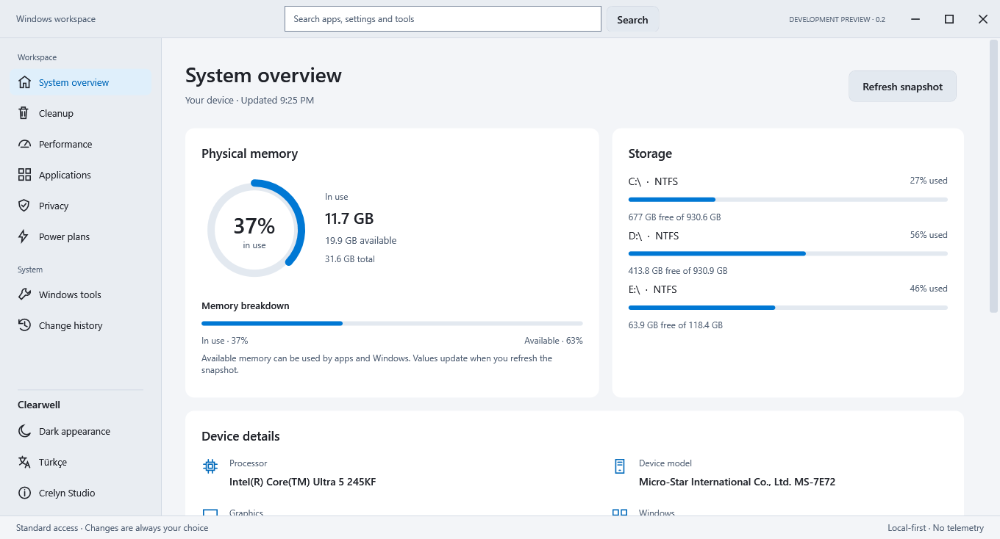
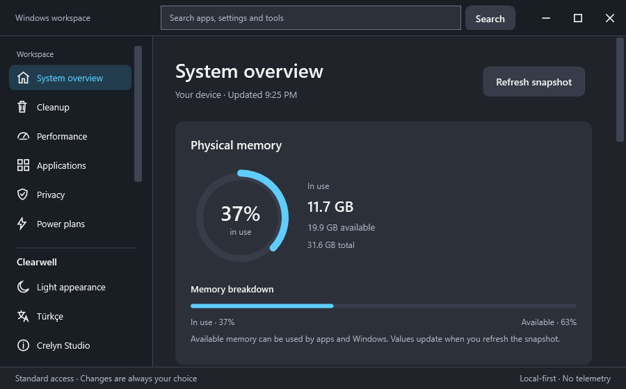
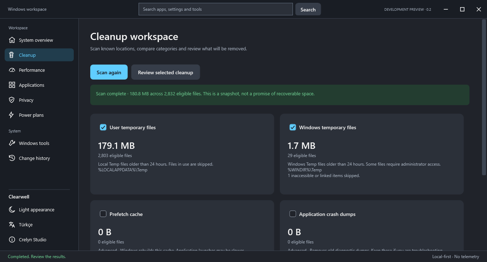
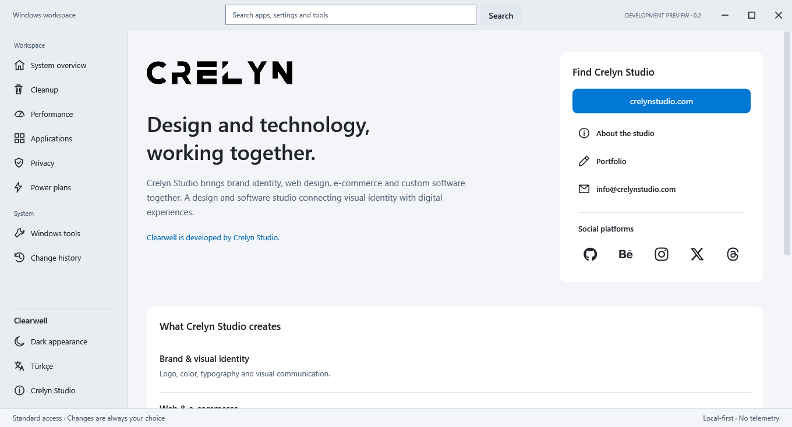
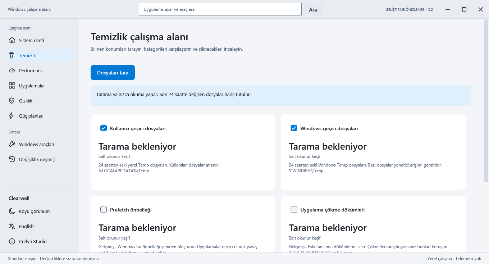
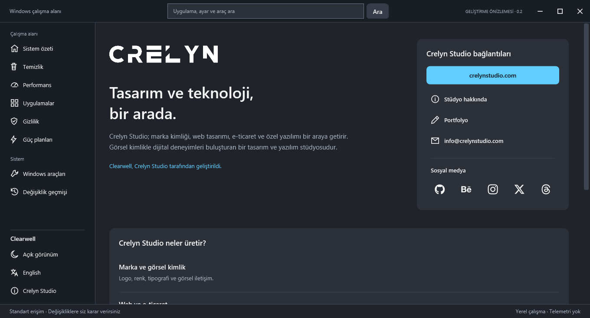

# Clearwell

**Windows maintenance, with the details in plain sight.** A native C# / WPF desktop utility with English and Turkish, dark and light appearances, and a review-before-change workflow.

**0.2.0-preview.1 — development preview. Approved for preview publication.** Windows 10 testing and real-world system changes still require isolated-machine validation. This is not a stable maintenance recommendation.


## What it does

- Shows actual processor, active display adapter, device model and Windows version; a physical-memory chart and fixed-volume bars refresh on request, without a monitoring service.
- Uses a graphite/cyan interface with dark and light appearances, a quiet caption, and separate Discover / Installed apps views. The original non-letter icon combines data layers and a cleaning sweep.
- Searches workspace pages, preferences and applications. Filters the curated app library by category/name and reviews selected apps before sequential installation; the queue stops at the first failure.
- Includes 112 applications across browsers, communication, development, media, productivity, utilities, games and runtimes. WhatsApp installs from Microsoft Store; a WhatsApp account and Store availability are required. Examples: WinRAR, Acrobat Reader, Microsoft Office, Visual Studio, HWiNFO, Steam, .NET, Visual C++ and DirectX. Publisher requirements, accounts and licenses vary by application.
- Opens ten built-in Windows tools, including Task Manager, Device Manager, storage, recovery and Windows Update controls. These shortcuts do not change policies automatically.
- Read-only scanning of standard user Temp, Windows Temp, Prefetch and application crash dumps; confirmed permanent deletion of selected eligible files.
- Excludes files modified in the last 24 hours, links/reparse points, locked files and files changed since the scan. Prefetch/crash dumps start unselected.
- Explains user-scoped game-capture, visual-effects and privacy preferences before applying them; records original values for undo.
- Inspects startup Run keys and startup folders, with Windows Settings for enabling/disabling entries.
- Installs a curated catalog or an exact package ID through WinGet; uninstalls by exact package ID or opens Windows installed-app management.
- Lists actual power plans and switches between those your device provides, recording the previous plan.
- Custom minimize/maximize/close controls, keyboard focus, resizable window, reduced-motion support, and persistent local language/appearance preferences.








These are actual captures of the running preview. Hardware and scan totals are real results from the development environment, not performance promises. The library selection demonstrates the queue; it does not indicate installed apps. Paths are shown symbolically to avoid exposing user names.

## Run the portable preview

Open `Clearwell.exe` from the preview folder. Keep its accompanying license and notice files. This x64 build includes .NET; installing .NET separately is unnecessary. It is an unsigned development build, so Windows may display a reputation warning. Only run binaries from a source you trust; no security setting needs to be disabled.

Use standard privileges first. Windows Temp and Prefetch may contain inaccessible files; the app reports skipped items. The optional administrator restart requests Windows UAC permission and never starts a cleanup automatically. If another administrator account is used, its settings and history are separate.

The intended platforms are Windows 10 22H2 and Windows 11 x64. Only the development Windows 11 host has been exercised so far. No ARM64/x86 binaries are provided. Startup and maximization fit the current monitor work area, with per-monitor DPI awareness. The usual minimum is 900 × 560 logical pixels, reduced when the work area is smaller. Content remains scrollable. Physical mixed-DPI monitor switching still requires user testing.

## Build and check from source

The original Clearwell mark is defined in `src/Clearwell/Assets/Brand.xaml`. To regenerate its PNG and six-size Windows icon after editing the vector source, run `powershell -NoProfile -STA -File .\tools\Export-Icon.ps1` on Windows.

Requires Windows, PowerShell and a .NET 10 SDK. First restore/build and self-contained publish need internet to obtain Microsoft runtime components. No third-party UI NuGet packages are used.

Run from the repository root:

```powershell
dotnet build Clearwell.slnx -c Release
dotnet run --project src/Clearwell -c Release
dotnet run --project tests/Clearwell.Checks -c Release -- .\artifacts\checks-01
```

The checks directory must be empty or new. Checks create and delete **their own fixture files only**, including a directory junction; they do not alter Windows preferences, install applications or change power plans. Use a new checks directory on each run. Checks also read actual power plans.

To create the portable preview with runtime licenses:

```powershell
powershell -NoProfile -File .\publish.ps1
```

Output: `artifacts/Clearwell-0.2.0-preview.1-win-x64/`. A direct `dotnet publish` is insufficient for distribution unless you also include the runtime licenses and third-party notices copied by this script.

Optional read-only UI verification using the published preview:

```powershell
.\artifacts\Clearwell-0.2.0-preview.1-win-x64\Clearwell.exe --verify-ui .\artifacts\ui-proof
```

It renders every page in both languages/themes, checks twelve compact layouts at 1000 × 700 and 900 × 560, cancels a test confirmation, performs a read-only live scan and power-plan query, verifies catalog filtering/selection and workspace search, and tests preference persistence in an isolated profile beneath that output folder. It exits automatically and writes `result.txt`. It never executes deletion or applies system changes. Generated files are ignored by Git; do not upload `artifacts`, `bin` or `obj` manually.

## Data, privacy and recovery

Normal-use settings: `%LOCALAPPDATA%\CrelynStudio\Clearwell\preferences.json`. Recovery records: `changes.json` in the same folder. Records contain setting IDs, previous/new values, timestamps and state; no file listing or telemetry is uploaded. There is one running instance per user. Do not remove recovery records if you want to undo changes.

Recovery data is saved before mutation. Corrupt/unreadable recovery data blocks further preference/power mutations and is preserved. History marks interrupted operations as pending. Undo refuses to overwrite a setting that no longer matches the recorded applied value. Sign-out/restart may be needed; Windows policy can override user preferences. **This is preference recovery, not a full system backup or Windows restore point.**

Deletion is permanent. Filesystem metadata and the final file handle are checked again before deletion; a changed/locked file is skipped. There is a 100,000-entry scan limit per category, with partial results identified. Only standard Temp locations are included; a custom relocated `%TEMP%` directory is not scanned. Crash dumps may be useful for troubleshooting. Prefetch is a rebuilding Windows cache, not a guaranteed performance improvement.

## Internet and external tools

The UI, cleanup, settings and power controls make no network requests and need no account/API key. Native Windows settings links open locally; developer website/social links open externally only when clicked. A self-contained executable includes its runtime for first-launch offline use.

Application installation uses the separately installed **Microsoft WinGet/App Installer**, internet, third-party sources and publisher installers. Source/package agreements are explicit in the app's confirmation. WinGet may be absent on some machines; the application provides an official App Installer link and Windows management fallback. Installers may show UAC or their own dialogs. Installer actions have no automatic undo; a timeout does not guarantee a child installer stopped. No claim of every installer being offline-capable is made.

## Limits and validation status

Validation: 65 automated checks passed, plus 40 full and 12 compact native UI renders. A fresh source copy built and published successfully; the portable ZIP was extracted separately and verified. These checks do not cover the live operations listed below.

Automated fixture checks, compile checks and actual WPF rendering were run. The developer machine was only read/scanned. **Actual Windows preference mutation/undo, power switching, UAC relaunch and WinGet install/uninstall were not executed on the user's machine.** They require a disposable Windows 10/11 VM before public release. Screen-reader use and high-DPI/multiple-monitor behavior require manual checks. A native interface avoids a bundled browser engine but does not guarantee a particular RAM limit.

The installed-app list reads desktop uninstall registrations; Store apps may be absent. Display names are not WinGet IDs. Startup inspection excludes services and scheduled tasks. Suggestions and personalization differ by Windows version/policy. Available power plans depend on hardware. No registry cleaner, antivirus disabling, driver updater, scheduled service, “RAM booster” or guaranteed FPS claim is included.

## Try the preview

1. Switch language and appearance; close/reopen to confirm they persist.
2. Resize and use Tab/Shift+Tab, Space, Enter, Escape, minimize and maximize.
3. Run a cleanup scan; verify Prefetch and crash dumps remain unselected. Open review and cancel; no files should be deleted.
4. Inspect performance/privacy explanations and the current saved preference. Read startup entries and available power plans.
5. Compare the hardware snapshot with Task Manager, then refresh. Search for Firefox and Task Manager; filter the app library and select two apps without starting installation. Resize to check the compact queue and catalog.
6. In a disposable VM, test one preference change and undo; then power switching/undo, UAC, known-app install/uninstall and a controlled cleanup. Do not use important personal files as test fixtures.

## License and developer

Source: [MIT](LICENSE), copyright 2026 Crelyn Studio. Included .NET and Windows Desktop runtime components have their own licenses/notices. Crelyn Studio names and logos are reserved brand assets; the software license grants no trademark rights. See [third-party notices](THIRD-PARTY-NOTICES.txt).

**Developed by Crelyn Studio.** [Website](https://crelynstudio.com) · [Email](mailto:info@crelynstudio.com) · [GitHub](https://github.com/crelynstudio). Developer details and social links are also available inside the app. Independently implemented; not affiliated with Microsoft or Chris Titus Tech. No WinUtil code is bundled.

---

# Türkçe

**Clearwell, işlemleri açıklayarak sunan Windows bakım aracıdır.** C# / WPF tabanlı yerel masaüstü uygulaması; İngilizce/Türkçe, açık/koyu tema ve değişiklikten önce inceleme akışı sunar.

**0.2.0-preview.1 geliştirme sürümüdür. Önizleme yayını onaylandı.** Windows 10 ve gerçek sistem değişiklikleri yalıtılmış makinelerde ayrıca doğrulanmalıdır.

## Özellikler

- Gerçek işlemci, etkin görüntü bağdaştırıcısı, cihaz modeli ve Windows sürümü; isteğe bağlı yenilenen fiziksel bellek grafiği ve sabit birim çubukları. Sürekli izleme hizmeti yoktur.
- Grafit gri/mavi arayüz, açık ve koyu görünüm, sade pencere başlığı ve ayrı Keşfet / Kurulu uygulamalar görünümleri. Özgün harfsiz simge, veri katmanlarını temizleme hareketiyle birleştirir.
- Sayfa, tercih, uygulama ve Windows araçlarında arama; kategori/ad filtreli uygulama kütüphanesi, incelenebilir seçim ve sıralı kurulum. İlk kurulum hatasında sıra durur.
- Görev Yöneticisi, Aygıt Yöneticisi, depolama, kurtarma ve Windows Update dahil on yerleşik Windows aracına erişim. Kısayollar ilkeleri kendiliğinden değiştirmez.
- Standart kullanıcı Temp, Windows Temp, Prefetch ve çökme dökümlerini salt okunur tarama; seçili dosyaları onaydan sonra kalıcı silme.
- Son 24 saatte değişen, bağlantılı, kilitli veya taramadan sonra değişmiş dosyaları atlama. Prefetch ve çökme dökümleri başlangıçta seçili değildir.
- Oyun kaydı, görsel efektler ve gizlilik tercihlerini etkilerini açıklayarak uygulama; eski değerleri geri almak için kaydetme.
- Başlangıç kayıtlarını inceleme; açıp kapatma için Windows Ayarları'na geçme.
- WinGet ile seçilmiş katalogdan veya tam paket kimliğiyle kurma/kaldırma; Windows uygulama yönetimine erişim.
- Cihazda bulunan güç planlarını listeleme, değiştirme ve önceki plana dönme.
- Özel pencere düğmeleri, klavye odağı, yeniden boyutlandırma, azaltılmış hareket desteği ve kalıcı dil/tema tercihleri.




Ekran görüntüleri çalışan uygulamadan alınmıştır. Donanım ve temizlik miktarları geliştirme ortamındaki gerçek sonuçlardır; performans vaadi değildir. Kütüphanedeki seçim yalnızca kurulum sırasını gösterir; uygulamalar kurulmadı. Kullanıcı adını göstermemek için yollar sembolik sunulur.

## Çalıştırma ve geliştirme

Geliştirme sürümü klasöründeki `Clearwell.exe` dosyasını açın. Lisans ve bildirim dosyalarını yanında tutun. .NET içerir; ayrıca kurmanız gerekmez. İmzasız geliştirme sürümü olduğundan Windows itibar uyarısı gösterebilir. Güvenlik ayarlarını kapatmanız gerekmez.

Önce standart yetkilerle kullanın. Windows Temp ve Prefetch için bazı dosyalar atlanabilir. Yönetici olarak yeniden başlatma Windows izni ister; otomatik temizlik başlatmaz. Farklı yönetici hesabının ayarları/geçmişi ayrıdır.

Hedef Windows 10 22H2 ve Windows 11 x64'tür; şu an yalnızca geliştirme ortamındaki Windows 11 denendi. ARM64/x86 sürümü yoktur. Açılış ve büyütme mevcut monitörün kullanılabilir alanına sığar; monitöre göre DPI farkındalığı vardır. Olağan alt sınır 900 × 560 mantıksal pikseldir; ekran alanı daha küçükse sınır azaltılır. İçerik kaydırılabilir. Farklı DPI kullanan fiziksel monitörler arasında geçiş kullanıcı denemesi bekler.

Özgün Clearwell simgesinin vektör kaynağı `src/Clearwell/Assets/Brand.xaml` dosyasıdır. PNG ve altı boyutlu Windows simgesini yeniden üretmek için Windows üzerinde `powershell -NoProfile -STA -File .\tools\Export-Icon.ps1` çalıştırın.

Kaynak kod için Windows, PowerShell ve .NET 10 SDK gerekir. İlk bağımlılık yükleme ve taşınabilir derleme Microsoft bileşenleri için internet gerektirir. Üçüncü taraf arayüz paketi yoktur. Depo kökünde:

```powershell
dotnet build Clearwell.slnx -c Release
dotnet run --project src/Clearwell -c Release
dotnet run --project tests/Clearwell.Checks -c Release -- .\artifacts\kontrol-01
powershell -NoProfile -File .\publish.ps1
```

Kontrol klasörü boş/yeni olmalıdır; her koşuda yeni ad kullanın. Testler yalnızca kendi dosyalarını oluşturup siler; sistem ayarı, uygulama veya güç planı değiştirmez. Mevcut güç planlarını okur. Derleme çıktısı `artifacts/Clearwell-0.2.0-preview.1-win-x64/` olur. Dağıtım için .NET lisans/bildirimlerini de kopyalayan `publish.ps1` kullanılmalıdır.

İsteğe bağlı arayüz kontrolü için üstteki `--verify-ui` komutunu kullanın. İki dil/temada gerçek ekranlar üretir; küçük pencereyi, onay iptalini, salt okunur taramayı, güç planı okumasını ve ayrı profilde tercih kaydını kontrol eder. Sonucu `result.txt` dosyasına yazar. Sistem değişikliği veya temizlik çalıştırmaz. `artifacts`, `bin`, `obj` klasörlerini GitHub'a elle yüklemeyin.

## Gizlilik, kurtarma ve sınırlar

Tercihler `%LOCALAPPDATA%\CrelynStudio\Clearwell\preferences.json`, ayar/güç kurtarma kayıtları aynı yerdeki `changes.json` dosyasında tutulur. Geçmişte ayar kimliği, önceki/yeni değer, zaman ve durum bulunur. Dosya listesi/telemetri gönderilmez. Kullanıcı başına tek örnek çalışır. Geri alma istiyorsanız geçmişi silmeyin.

Özgün değerler değişiklikten önce kaydedilir. Bozuk/okunamayan kurtarma verileri korunur ve yeni ayar/güç değişiklikleri engellenir. Kesilmiş işlem bekliyor görünür. Başka program mevcut değeri değiştirmişse geri alma üzerine yazmayı reddeder. Oturumu kapatma/yeniden başlatma gerekebilir; sistem ilkeleri tercihleri geçersiz kılabilir. **Bu mekanizma tam sistem yedeği veya Windows geri yükleme noktası değildir.**

Dosya silme kalıcıdır. Silmeden önce dosya bilgileri ve gerçek dosya tanıtıcısı yeniden kontrol edilir. Her kategoride 100.000 öğe sınırı vardır; kısmi sonuç belirtilir. Standart konumlar taranır; başka konuma taşınmış `%TEMP%` taranmaz. Prefetch silmek garantili hız artışı sağlamaz; çökme dökümleri hata araştırmada gerekli olabilir.

Arayüz, temizlik, ayar ve güç işlemleri ağ isteği yapmaz; hesap/API anahtarı istemez. Yerel Windows bağlantıları ayarları açar. Geliştirici/sosyal bağlantılar yalnızca tıklanınca dışarıda açılır. Taşınabilir sürüm çalışma zamanını içerdiğinden ilk açılış için .NET indirmez.

Uygulama kurmak ayrı kurulu Microsoft WinGet/App Installer, internet ve yayıncı kurucuları gerektirir. Kaynak/paket sözleşmeleri onayda açıklanır. WinGet yoksa resmi App Installer bağlantısı ve Windows yönetim seçeneği gösterilir. Kurucular yönetici izni veya kendi pencerelerini açabilir. Kurma/kaldırmanın otomatik geri alması yoktur. Zaman aşımı alt kurucunun durduğunu garanti etmez; tüm kurulumların çevrimdışı çalıştığı iddia edilmez.

Otomatik dosya güvenliği kontrolleri, derleme ve WPF ekran üretimi çalıştırıldı. Kullanıcının bilgisayarında yalnızca okuma/tarama yapıldı. **Gerçek ayar değiştirme/geri alma, güç değiştirme, yönetici yeniden başlatması ve WinGet kurma/kaldırma çalıştırılmadı.** Yayından önce geçici Windows 10/11 sanal makinesinde denenmelidir. Ekran okuyucu, yüksek DPI ve çoklu ekran manuel kontrol bekliyor. Sabit RAM sınırı garanti edilmez.

Kurulu liste masaüstü kaldırma kayıtlarını okur; Store uygulamaları eksik olabilir. Uygulama adları WinGet kimliği değildir. Başlangıç incelemesi hizmet/zamanlanmış görevleri kapsamaz. Gizlilik/öneriler Windows sürümüne ve ilkelere göre değişir. Güç planları donanıma bağlıdır. Kayıt defteri temizliği, antivirüs kapatma, sürücü güncelleme, arka plan hizmeti, RAM boşaltıcı veya FPS garantisi yoktur.

## Deneme listesi

Kütüphanede tarayıcılar, iletişim, geliştirme, medya, üretkenlik, yardımcı araçlar, oyunlar ve çalışma zamanları olmak üzere sekiz kategoride 112 uygulama bulunur. WhatsApp, Microsoft Store üzerinden kurulur; WhatsApp hesabı ve Store erişimi gerekir. Örnekler: WinRAR, Acrobat Reader, Microsoft Office, Visual Studio, HWiNFO, Steam, .NET, Visual C++ ve DirectX. Yayıncı gereksinimleri, hesap ihtiyacı ve lisanslar uygulamaya göre değişir.

Doğrulama: 65 otomatik kontrol, 40 tam ve 12 küçük yerel arayüz görünümü geçti. Temiz kaynak kopyasında derleme ve taşınabilir sürüm üretimi doğrulandı; ZIP ayrı klasöre açılarak denendi. Bu kontroller yukarıda belirtilen gerçek sistem değişikliği denemelerini kapsamaz.

1. Dil/temayı değiştirin; uygulamayı kapatıp açınca korunduğunu kontrol edin.
2. Pencereyi boyutlandırın; Tab/Shift+Tab, Space, Enter, Escape, küçültme ve büyütmeyi deneyin.
3. Temizlik taraması yapın; Prefetch/dökümler seçilmemiş olsun. İncelemeyi açıp iptal edin; hiçbir dosya silinmemeli.
4. Ayar açıklamalarını ve kayıtlı tercihi inceleyin. Başlangıç kayıtlarını ve güç planlarını okuyun.
5. Geçici sanal makinede bir ayarı değiştirip geri alın; güç, yönetici izni, uygulama kurma/kaldırma ve kontrollü temizlik deneyin. Önemli dosyaları test girdisi yapmayın.
6. Donanım özetini Görev Yöneticisi ile karşılaştırıp yenileyin. Firefox ve Aygıt Yöneticisi arayın; kütüphaneyi filtreleyip kurulumu başlatmadan iki uygulama seçin. Küçük pencerede seçim şeridini ve kataloğu inceleyin.

Kaynak kod [MIT](LICENSE) lisanslıdır. Telif: 2026 Crelyn Studio. .NET bileşenlerinin kendi lisansları vardır. Marka/logo hakları yazılım lisansından ayrıdır; [bildirimleri](THIRD-PARTY-NOTICES.txt) inceleyin.

**Crelyn Studio tarafından geliştirildi.** [Web sitesi](https://crelynstudio.com) · [E-posta](mailto:info@crelynstudio.com) · [GitHub](https://github.com/crelynstudio). Uygulamadaki Hakkında alanında diğer profiller bulunur. Microsoft/Chris Titus Tech ile bağlantısı yoktur; WinUtil kodu kullanılmamıştır.
